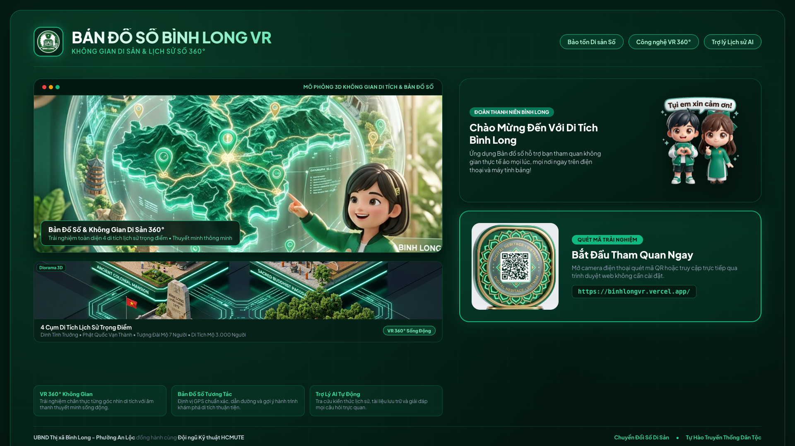
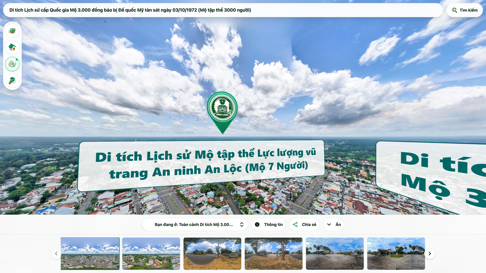
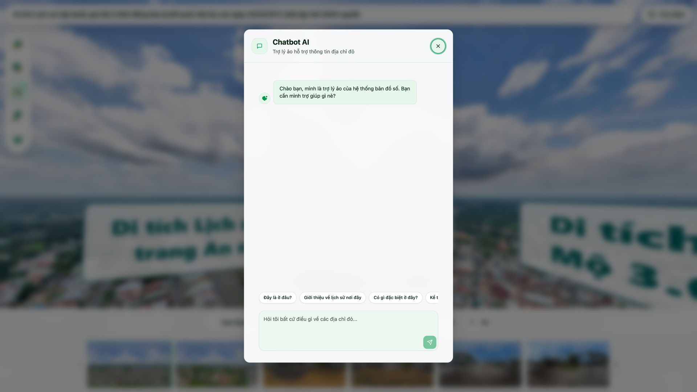

# TÀI LIỆU BÀN GIAO KỸ THUẬT & HƯỚNG DẪN SỬ DỤNG
## Hệ Thống Bản Đồ Số & Không Gian Di Tích VR 360° Bình Long

---

### 1. Thông Tin Hệ Thống Trực Tuyến

| Hạng mục | Chi tiết |
| :--- | :--- |
| **Website chính thức** | [https://binhlongvr.vercel.app/](https://binhlongvr.vercel.app/) |
| **Nền tảng hạ tầng** | Vercel Cloud Edge Network |
| **Mã nguồn GitHub** | `toantc1024/binhlongvr` |
| **Công nghệ** | React 18, Tailwind CSS, Marzipano 360 VR, MapLibre GIS, AI Assistant |
| **Đơn vị tiếp nhận** | UBND Thị xã Bình Long - Phường An Lộc |
| **Đơn vị bàn giao** | Đội ngũ Kỹ thuật HCMUTE |

---

### 2. Quy Trình Vận Hành & Khai Thác 5 Bước (Trực Quan)

#### Bước 1: Quét mã QR hoặc truy cập trực tiếp

- **Hành động 1:** Mở camera điện thoại hướng về mã QR đặt tại bảng di tích.
- **Hành động 2:** Chạm vào liên kết để mở trực tiếp trên trình duyệt web không cần cài đặt ứng dụng.
- **Hành động 3:** Tương thích trên cả điện thoại Android, iPhone, iPad và màn hình cảm ứng công cộng.

---

#### Bước 2: Khám phá Bản đồ số GIS & Chọn di tích

- **Hành động 1:** Nhấn vào biểu tượng **Bản đồ số** trên thanh công cụ.
- **Hành động 2:** Chọn điểm di tích cần đến: *Mộ 3.000 người, Dinh Tỉnh Trưởng, Mộ 7 người, Phật Quốc Vạn Thành*.
- **Hành động 3:** Xem thông tin khái quát, tọa độ định vị và nhấn nút vào tham quan.

---

#### Bước 3: Trải nghiệm không gian thực tế ảo 360°

- **Hành động 1:** Dùng ngón tay vuốt hoặc rê chuột để xoay 360 độ ngắm toàn cảnh di tích.
- **Hành động 2:** Cuộn chuột hoặc chụm 2 ngón tay để phóng to, quan sát cận cảnh bia tích và hiện vật.
- **Hành động 3:** Bật chế độ toàn màn hình để có góc nhìn rộng và chân thực nhất.

---

#### Bước 4: Khám phá Địa đạo ngầm & Điểm thông tin tương tác

- **Hành động 1:** Chạm vào các điểm Hotspot nhấp nháy trên màn hình để mở hộp thoại thông tin tư liệu.
- **Hành động 2:** Chạm vào mũi tên điều hướng để chuyển cảnh xuống hầm địa đạo kháng chiến.
- **Hành động 3:** Đọc tư liệu ảnh phục dựng và cấu trúc hầm bí mật thời kỳ chiến tranh.

---

#### Bước 5: Thuyết minh âm thanh & Trợ lý hỏi đáp AI

- **Hành động 1:** Bấm biểu tượng loa âm thanh để lắng nghe giọng đọc thuyết minh tự động.
- **Hành động 2:** Bấm biểu tượng **Hỏi đáp AI** để kích hoạt trợ lý lịch sử thông minh.
- **Hành động 3:** Nhập câu hỏi thắc mắc về trận đánh Bình Long, nhân vật và sự kiện lịch sử để nhận phản hồi ngay lập tức.

---

### 3. Danh Mục Nghiệm Thu Bàn Giao Kỹ Thuật

| STT | Hạng mục bàn giao | Mô tả trạng thái | Đánh giá |
| :---: | :--- | :--- | :---: |
| **01** | Hệ thống Web App Bản Đồ Số | Giao diện chuẩn responsive, chạy mượt mà trên di động và PC | **ĐẠT** |
| **02** | Dữ liệu VR 360° 4 Di Tích | 4 cụm di tích lịch sử kèm điểm tương tác không gian | **ĐẠT** |
| **03** | Thuyết minh âm thanh & AI Chatbot | Audio thuyết minh chất lượng cao, Chatbot AI phản hồi ổn định | **ĐẠT** |
| **04** | Bộ mã QR Bản Đồ Số | File trong suốt, file chuẩn và thẻ in ấn đã kiểm tra quét 100% | **ĐẠT** |
| **05** | Bộ Poster & Standee | Poster ngang và Standee đứng kết hợp ảnh chụp thật và Chibi | **ĐẠT** |
| **06** | Hướng dẫn vận hành & Mã nguồn | Kho GitHub đầy đủ, hướng dẫn ít chữ trực quan dễ tiếp nhận | **ĐẠT** |

---

### 4. Xác Nhận Nghiệm Thu & Bàn Giao

| ĐẠI DIỆN ĐỘI NGŨ KỸ THUẬT (HCMUTE) | ĐẠI DIỆN ĐƠN VỊ TIẾP NHẬN (UBND BÌNH LONG) |
| :---: | :---: |
| *(Ký và ghi rõ họ tên)* | *(Ký và đóng dấu)* |
|    **Đội Ngũ Kỹ Thuật HCMUTE** |    **Ban Quản Lý & Vận Hành Di Tích** |
