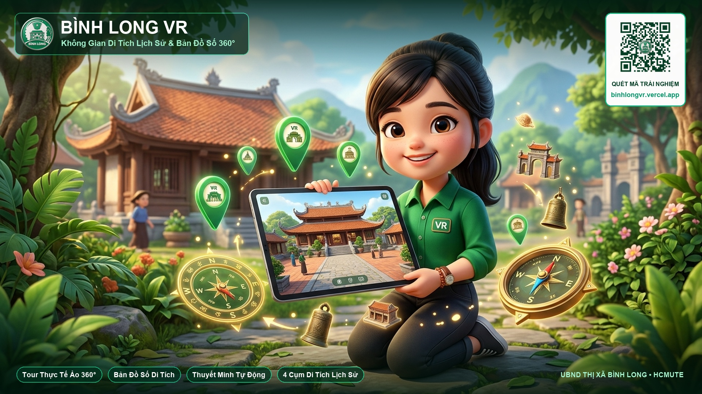
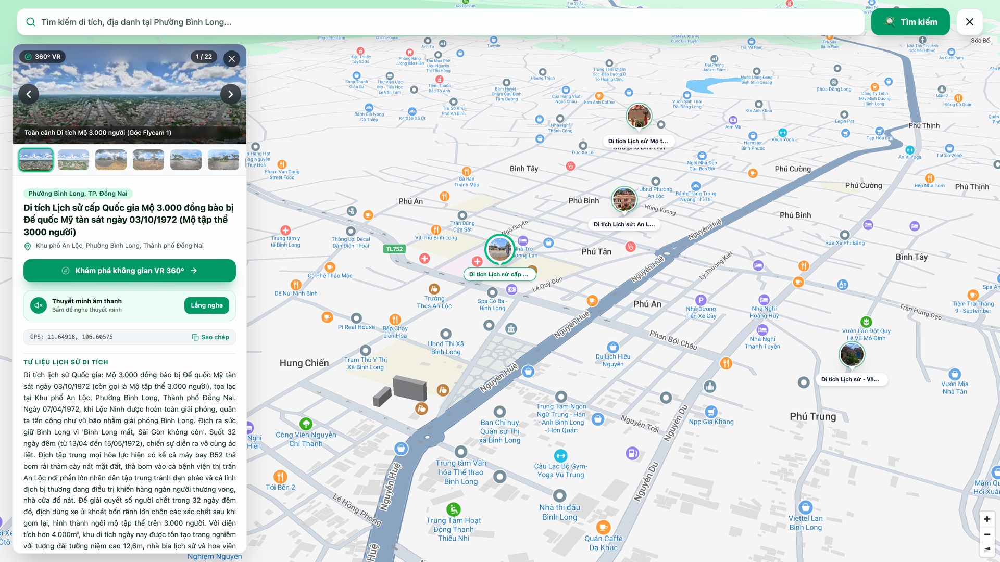
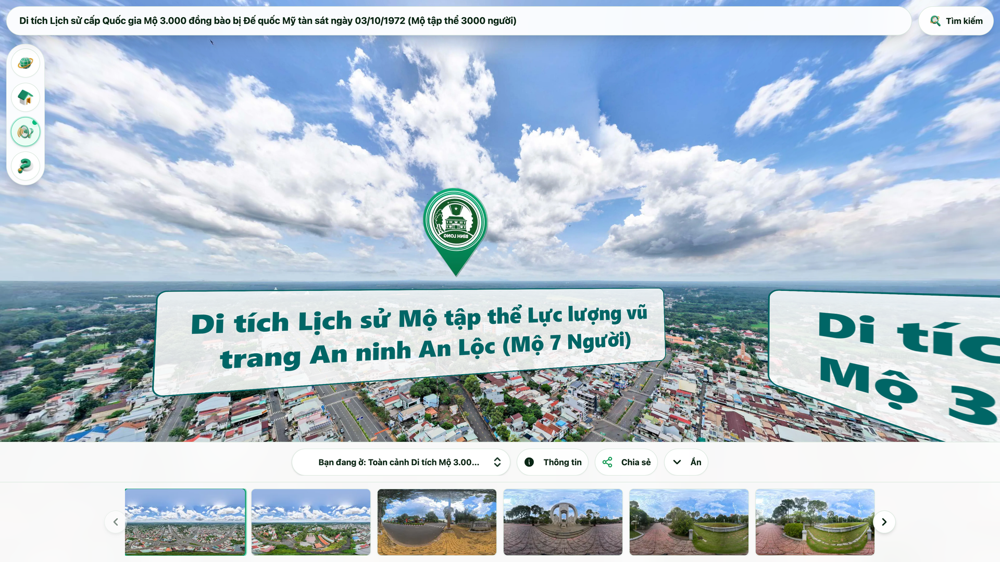
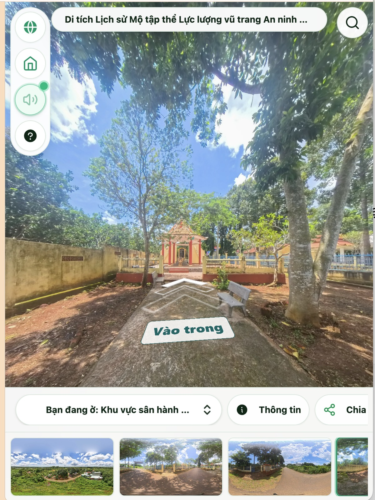
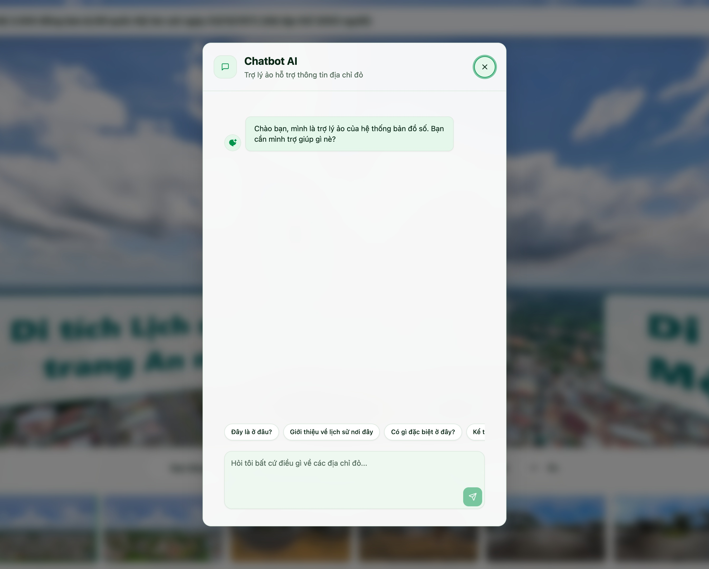

# TÀI LIỆU BÀN GIAO KỸ THUẬT & HƯỚNG DẪN VẬN HÀNH
## Hệ Thống Bản Đồ Số & Không Gian Di Tích VR 360° Bình Long

---

### 1. Thông Tin Nhận Diện & Hạ Tầng Kỹ Thuật

| Hạng mục | Chi tiết kỹ thuật |
| :--- | :--- |
| **Website chính thức** | [https://binhlongvr.vercel.app/](https://binhlongvr.vercel.app/) |
| **Loại ứng dụng** | Bản đồ số GIS & Không gian thực tế ảo 360° đa nền tảng |
| **Hạ tầng lưu trữ** | Vercel Global Edge Network (Bảo mật SSL/TLS 1.3) |
| **Kho mã nguồn GitHub** | [https://github.com/toantc1024/binhlongvr](https://github.com/toantc1024/binhlongvr) |
| **Đơn vị tiếp nhận** | UBND Thị xã Bình Long - Phường An Lộc |
| **Đơn vị bàn giao** | Đội ngũ Kỹ thuật HCMUTE |

#### Nhận Diện Biểu Trưng & Mã QR Trực Tuyến
- **Logo chính thức:** `assets/logo_vr.png`
- **Mã QR trực tuyến:** `assets/qr_binhlong_transparent_logo.png` (PNG 32-bit trong suốt, ECC Level H, quét nhạy 100%)
- **Đích quét:** `https://binhlongvr.vercel.app/`

---

### 2. Chi Tiết 4 Cụm Di Tích Lịch Sử Được Số Hóa Toàn Diện

1. **Dinh Tỉnh Trưởng Bình Long:** Công trình kiến trúc Pháp 2 tầng kiên cố, trung tâm chỉ huy quân sự lịch sử trong chiến dịch giải phóng Bình Long năm 1972. Số hóa 4 góc nhìn VR toàn cảnh: mặt tiền chính, sảnh khánh tiết, khuôn viên chứng tích và đường hầm ngầm kiên cố.
2. **Khu Di Tích Mộ 3.000 Người:** Địa chỉ đỏ lịch sử ghi dấu nơi an nghỉ tập thể của hơn 3.000 đồng bào và chiến sĩ tử nạn trong trận đánh ác liệt năm 1972. Tích hợp không gian tưởng niệm trang nghiêm, văn bia lịch sử, khu hoa viên và giọng đọc thuyết minh âm thanh xúc động.
3. **Khu Di Tích Mộ 7 Người:** Nơi ghi nhớ sự hy sinh oanh liệt của 7 chiến sĩ anh dũng thuộc đơn vị vũ trang cách mạng địa phương kiên cường giữ chốt bảo vệ căn cứ. Số hóa chi tiết bia tưởng niệm, khuôn viên cây xanh và tư liệu ảnh lịch sử.
4. **Chùa Phật Quốc Vạn Thành:** Điểm nhấn du lịch văn hóa tâm linh nổi tiếng của thị xã Bình Long với đại tượng Đức Phật Thích Ca Mâu Ni ngồi thiền cao 73m lớn nhất Đông Nam Á. Số hóa góc nhìn trên cao toàn cảnh thị xã và quần thể chánh điện thanh tịnh.

---

### 3. Quy Trình Vận Hành & Khai Thác 5 Bước (Trực Quan)

#### Bước 1: Quét mã QR hoặc truy cập trực tuyến

- **1. Mở máy ảnh điện thoại:** Hướng camera về mã QR đặt tại bảng chỉ dẫn di tích hoặc ấn phẩm in truyền thông.
- **2. Mở đường dẫn trực tiếp:** Hệ thống tự động mở website trên trình duyệt mà không cần cài đặt thêm ứng dụng bên ngoài.
- **3. Tương thích đa nền tảng:** Tối ưu hiển thị cho điện thoại iOS, Android, máy tính bảng và màn hình cảm ứng công cộng.

---

#### Bước 2: Bản đồ số GIS & Chọn điểm di tích

- **1. Mở bản đồ số:** Nhấn biểu tượng Bản đồ trên thanh điều khiển để quan sát toàn cảnh các di tích Bình Long.
- **2. Chọn di tích cần đến:** Chạm vào điểm ghim: Dinh Tỉnh Trưởng, Mộ 3.000 người, Mộ 7 người, Phật Quốc Vạn Thành.
- **3. Xem tóm tắt & tọa độ:** Đọc bảng thông tin nhanh và bấm nút Khám phá để chuyển ngay vào không gian 360°.

---

#### Bước 3: Trải nghiệm toàn cảnh VR 360°

- **1. Điều hướng không gian:** Vuốt màn hình hoặc rê chuột để xoay 360 độ ngắm nhìn toàn cảnh khuôn viên di tích.
- **2. Thu phóng linh hoạt:** Dùng hai ngón tay hoặc cuộn chuột để quan sát cận cảnh các văn bia, hiện vật lịch sử.
- **3. Góc nhìn toàn màn hình:** Nhấn nút phóng to góc màn hình để trải nghiệm góc nhìn rộng và chân thực nhất.

---

#### Bước 4: Khám phá cận cảnh không gian di tích & Điểm tương tác

- **1. Chuyển điểm quan sát:** Chạm nút "Vào trong" hoặc các mũi tên điều hướng để tiến gần hơn vào khu vực chính điện và văn bia.
- **2. Điểm tương tác không gian:** Chạm các biểu tượng Hotspot để xem bảng tư liệu ảnh, sơ đồ và thông tin sự kiện lịch sử.
- **3. Thanh chọn góc nhìn nhanh:** Chọn các góc nhìn toàn cảnh khác nhau qua thanh ảnh thu nhỏ bên dưới màn hình.

---

#### Bước 5: Thuyết minh âm thanh & Trợ lý lịch sử AI

- **1. Bật thuyết minh âm thanh:** Nhấn biểu tượng loa để nghe giọng đọc truyền cảm về ý nghĩa lịch sử của di tích.
- **2. Mở Trợ lý Lịch sử AI:** Nhấn biểu tượng Hỏi đáp AI trên màn hình để kích hoạt trợ lý tra cứu thông tin thông minh.
- **3. Tra cứu tức thì:** Nhập câu hỏi về trận đánh Bình Long, nhân vật và sự kiện lịch sử để nhận phản hồi nhanh chóng, chính xác.

---

### 4. Tiêu Chuẩn Kỹ Thuật Lắp Đặt Bảng Mã QR Thực Địa

- **Chất liệu bảng ngoài trời:** Sử dụng Mica Đài Loan trong suốt dày 5mm hoặc Inox 304 ăn mòn in UV phủ bóng bảo vệ, chống nắng mưa thời tiết nhiệt đới.
- **Kích thước bảng chuẩn:** Bảng chỉ dẫn chính tại cổng 200 × 200 mm; bảng phụ tại chân bia di tích 100 × 100 mm.
- **Vị trí và góc nghiêng:** Chiều cao từ 1.2m đến 1.4m so với mặt đất, nghiêng 15 - 20 độ để tránh chói sáng khi quét bằng camera điện thoại.

---

### 5. Danh Mục Nghiệm Thu Bàn Giao Kỹ Thuật

| STT | Hạng mục bàn giao | Mô tả trạng thái kỹ thuật | Đánh giá |
| :---: | :--- | :--- | :---: |
| **01** | Hệ thống Web App Bản Đồ Số | Giao diện chuẩn responsive, tương thích 100% điện thoại và máy tính | **ĐẠT CHUẨN** |
| **02** | Dữ liệu VR 360° 4 Cụm Di Tích | 4 cụm di tích lịch sử kèm điểm tương tác không gian và hầm ngầm | **ĐẠT CHUẨN** |
| **03** | Thuyết Minh Âm Thanh & AI Hỏi Đáp | Audio thuyết minh chất lượng cao, Chatbot AI phản hồi ổn định | **ĐẠT CHUẨN** |
| **04** | Bộ Mã QR Bản Đồ Số | Bộ mã QR file trong suốt và thẻ in ấn đã kiểm tra quét thực tế 100% | **ĐẠT CHUẨN** |
| **05** | Bộ Poster Tiếp Thị Có Chibi | Poster tiếp thị 16:9 và Standee 9:16 có mã QR và nhân vật chibi hướng dẫn | **ĐẠT CHUẨN** |
| **06** | Mã Nguồn & Tài Liệu Vận Hành | Toàn bộ mã nguồn trên GitHub kèm hướng dẫn vận hành chi tiết | **ĐẠT CHUẨN** |

---

### 6. Xác Nhận Nghiệm Thu & Tiếp Nhận Hệ Thống

| ĐẠI DIỆN ĐỘI NGŨ KỸ THUẬT (HCMUTE) | ĐẠI DIỆN ĐƠN VỊ TIẾP NHẬN (UBND BÌNH LONG) |
| :---: | :---: |
| *(Ký và ghi rõ họ tên)* | *(Ký và đóng dấu)* |
|    **Đội Ngũ Kỹ Thuật HCMUTE** |    **Ban Quản Lý & Vận Hành Di Tích** |
